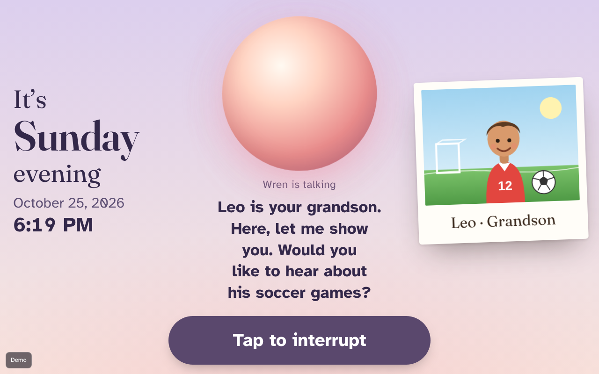
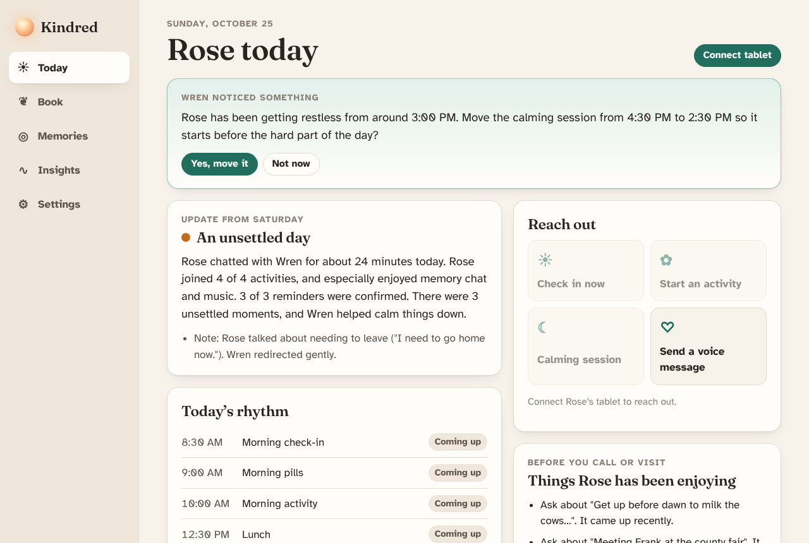
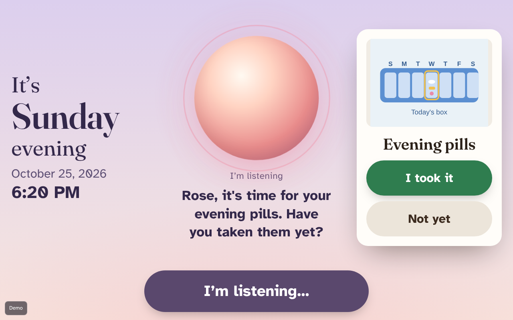
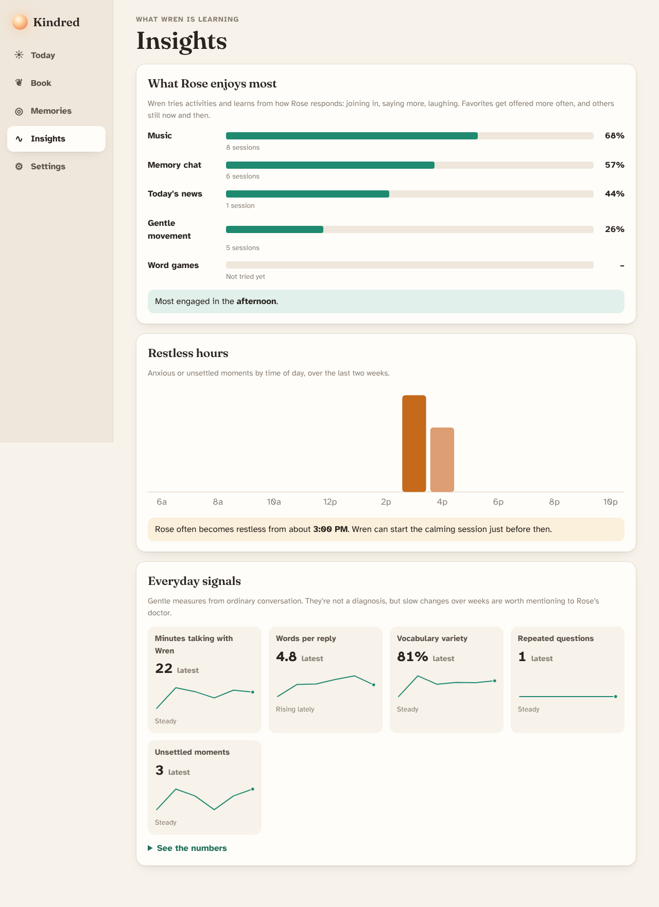

# Kindred

**A gentle AI companion for people living with dementia, and a window for the families who love them.**

Kindred is one web app with two sides:

- **The companion (Wren)** runs on a tablet in the person's home. It talks, remembers, keeps the day on track, and speaks first at the right moments: a morning check-in, a pill reminder with a photo of the actual pill box, a word game at 10, and a calming session timed for just before the afternoon gets hard.
- **The family app** runs on any phone. It brings urgent alerts the moment something is wrong, a warm nightly summary, a memory book that makes Wren personal, and *Rose's Book*: the life stories your loved one tells, kept in their own words.

Built on **Meta Muse Spark** (conversation, tool use, vision, nightly reflection) and **Muse Voice Transcribe** (speech to text).

| Companion tablet | Family app |
|---|---|
|  |  |
|  |  |

---

## Open it online (one click)

[](https://render.com/deploy?repo=https://github.com/tayle059/wren)

1. Click the button and sign in to Render with GitHub. The free plan is fine.
2. Leave `META_API_KEY` blank for now (or paste your key from dev.meta.ai), then click **Deploy Blueprint**.
3. After about 3 minutes, open the `https://kindred-….onrender.com` address Render shows and click **Try the live demo**.

On the free plan the server sleeps after 15 minutes without visitors (the first visit then takes about a minute to wake), and the demo resets to a fresh week each time it restarts. For a permanent home, use a paid Render plan with a disk, or Railway with a volume (`railway.json` and a `Dockerfile` are included). Set `DATA_DIR` to the disk's path.

## Run it on your computer

```bash
npm install
npm run seed      # builds Rose's world plus a simulated week of history
npm run build
npm start         # http://localhost:8787
```

1. Open http://localhost:8787 and click **Try the live demo with Rose and her family**. You're signed in as Rose's daughter, Sarah.
2. On **Today**, click **Connect tablet**, then **Open Rose's tablet in a new tab**. That tab is Rose's tablet: tap **Tap to wake Wren**.
3. Talk to Wren (allow the microphone), or use the **Demo director** panel to speak as Rose by typing. Try:
   - "Who is Leo?" → his photo slides in.
   - "Where is Frank?" → Wren never tells Rose her husband has died. It invites happy memories, and Sarah gets a quiet note.
   - "I fell and my hip hurts" → the tablet turns calm and amber, and an **urgent alert** appears in Sarah's app straight away.
4. Back in the family tab: **Reach out → Calming session**, then **Send a voice message**, then look at **Insights** and **Rose's Book**.

Without a Meta key, Kindred runs on its built-in **offline brain** and the browser's own speech recognition (Chrome or Safari), so the whole demo works out of the box. To use Muse Spark and Muse Voice Transcribe, copy `.env.example` to `.env` and set `META_API_KEY`.

For development: `npm run dev` (server and Vite with hot reload; open http://localhost:5173).

---

## What makes it different

**1. Safety that never depends on a model call.** Every utterance goes through three layers:

| Layer | When | What it does |
|---|---|---|
| Safety net (`server/brain/safety.ts`) | Before the model | Deterministic detection of falls, medical emergencies, danger at home, self-harm, extra medication, wanting to leave, and asking for someone who has died. Negation-aware ("I didn't fall"). **Urgent alerts are sent here**, so they arrive even if the AI is down. |
| Muse Spark with care rules (`prompts.ts`) | The reply | Dementia-care persona: never argue or correct, answer repeated questions fresh every time, validate feelings, never announce a death, never invent family facts, never give medical advice. Tools: memory lookup, show photo, play song, confirm reminder, raise concern, calm mode. |
| Reply guard (`guard.ts`) | After the model | Enforces the hard lines on whatever any brain says: blocks death announcements, strips "you already asked", replaces dosing advice, stops impersonating family, trims to three sentences, removes markdown before speech. |

If Muse Spark is slow or unavailable, the **offline brain** answers in the same voice with the same rules, so the conversation degrades gracefully instead of stopping.

**2. It learns each person.** Activities (memory chat, music, word games, gentle movement, today's news) are chosen by **Thompson sampling** over a Beta posterior per activity. The family's "About" notes set the starting beliefs, including dislikes ("crossword puzzles frustrate her"). Each session's engagement (turns, words, laughter, distress, completion) is the reward. Every night Muse Spark rewrites a short **"What works for Rose"** note that Wren reads before every conversation. Lines the family marks `[family]` are kept word for word.

**3. It sees sundowning coming.** Distress and exit-seeking are logged by hour. When a pattern appears (Rose gets restless from about 3 PM), Wren suggests moving the calming session earlier, and the family approves with one tap.

**4. Rose's Book.** When Rose tells a story, Muse Spark keeps it in her own words: title, era, her most vivid quote. The family can read and print it. One day it may hold the stories only they remember.

**5. Built for the person, not the demo.**
- **Orientation:** the day and time are always on screen, and the whole screen's light follows the time of day.
- **Patience:** the companion waits through long pauses before deciding someone has finished speaking, and the family can tune that patience.
- **Interrupting:** the person can talk over Wren and it stops to listen.
- **Readable:** large captions in Atkinson Hyperlegible, a font designed for low vision.
- **Simple:** one giant button and no menus.
- **Reminders:** big "I took it / Not yet" buttons.
- **Locked in:** a PIN-protected exit and a screen wake lock.
- **Noise:** a TV in the background won't hold a conversation open forever.

**6. For families, gentle signals rather than surveillance.**
- **Nightly summary:** a warm, honest note about the day.
- **Visit prep:** "Before you call: ask about the barn roof story. Gently avoid: selling the house."
- **Non-diagnostic trends:** minutes talking, words per reply, vocabulary variety (MATTR), repeated questions, and unsettled moments, with a table view.
- **Voice messages:** recorded in your real voice. No voice cloning.

**7. Photos that Wren understands.** When the family uploads a photo, Muse Spark looks at it and writes gentle conversation starters, so memory chats are about what's actually in the picture.

---

## How it fits together

```
 Tablet (companion mode)                    Phones (family mode)
  mic → voice-activity detector             alerts · summary · memory book · insights
  WAV ─────────┐        ▲ speech (on-device TTS)          ▲  live updates (SSE) + Web Push
               ▼        │                                 │
        ┌──────────────────────── Kindred server (Node + Hono) ────────────────────────┐
        │ /api/device/turn: Muse Voice Transcribe → safety net → alerts → Muse Spark   │
        │                    (tools) → reply guard → stored → reply + UI actions        │
        │ scheduler: invites, retries, missed check-ins, offline tablets, 9 PM reflect │
        │ learning: bandit · engagement · signals · sundown forecast · story keeper    │
        └──────────────── SQLite (node:sqlite) · signed private media URLs ────────────┘
```

- **One codebase:** TypeScript, React (Vite) PWA, Hono, SQLite. No other database or cloud services to set up.
- **Speech to text:** Muse Voice Transcribe (`POST /v1/asr/transcribe`). Names from the memory book are sent as keywords, so "Leo" isn't heard as "Leah".
- **Speech out:** the device's own voice (Web Speech API). No third-party voice service, and no audio leaves the home to be spoken.
- **Raw audio is never stored.** Only transcripts are kept. Media is served through short-lived signed URLs, and every family route checks membership.

### Project map

| Path | What's there |
|---|---|
| `server/brain/` | `index.ts` (turn pipeline), `safety.ts`, `guard.ts`, `museBrain.ts`, `offlineBrain.ts`, `prompts.ts`, `tools.ts`, `repetition.ts` |
| `server/adapt/` | `bandit.ts` (Thompson sampling), `engagement.ts`, `signals.ts` (MATTR, sundown forecast) |
| `server/jobs/` | `scheduler.ts`, `afterConversation.ts` (stories, concern review), `nightly.ts` (summary, What works, visit prep), `photos.ts` (vision prompts) |
| `server/routes/` | Family and device APIs |
| `server/seed.ts` | Rose's world, and a simulated week produced by running the real system |
| `web/src/companion/` | Tablet UI, `conversation.ts` (state machine), `voice.ts` (VAD + WAV), `speech.ts` |
| `web/src/family/` | Family app screens |
| `tests/` | Unit, care-scenario and system tests; `live-eval.ts` for the real model |
| `e2e/run.ts` | Real-browser test with a simulated microphone; writes `docs/screenshots/` |

---

## Tests

```bash
npm test            # 38 tests: care scenarios, guard, safety, bandit, scheduler, Muse tool loop (mocked API), HTTP
npm run build && npm run e2e   # real Chromium + fake microphone, family and tablet side by side
META_API_KEY=... npm run eval:live   # care scenarios against real Muse Spark, judged by Muse Spark
```

The end-to-end run checks:
- The voice loop from the microphone to Leo's photo.
- An urgent alert reaching the family app live.
- A reminder confirmed by tapping "I took it".
- That "Where is Frank?" never produces a death announcement.

---

## Deploying

- **Render:** use the button above (`render.yaml`).
- **Railway:** "Deploy from GitHub repo" (`railway.json`). Add a volume and set `DATA_DIR` to its mount path.
- **Anywhere with Docker:** the `Dockerfile` stores data in `/data`.

Settings:
- Set `META_API_KEY` to use Muse Spark and Muse Voice Transcribe.
- `KINDRED_AUTO_SEED=1` loads the demo family whenever the database is empty.
- The public address is detected on Render and Railway. Elsewhere, set `PUBLIC_URL`.

Microphones and push notifications need **HTTPS**, which all of the above provide. On iPhone, family members add Kindred to the Home Screen to receive push alerts. On the tablet, turn on Guided Access (iPad) or screen pinning (Android).

## Honest limits

- Kindred is **not a medical device or an emergency service**. Alerts go to family. They don't call 911.
- Without a Meta key, speech recognition uses the browser's recognizer. Chrome and Safari send that audio to Google or Apple. With a key, speech goes only to Meta's API.
- The everyday signals are gentle trends for conversations with a doctor, not a diagnosis.
- The demo family is fictional, the photos are illustrations, and "Amazing Grace" is a public-domain melody rendered by the app's own music-box synthesizer.
